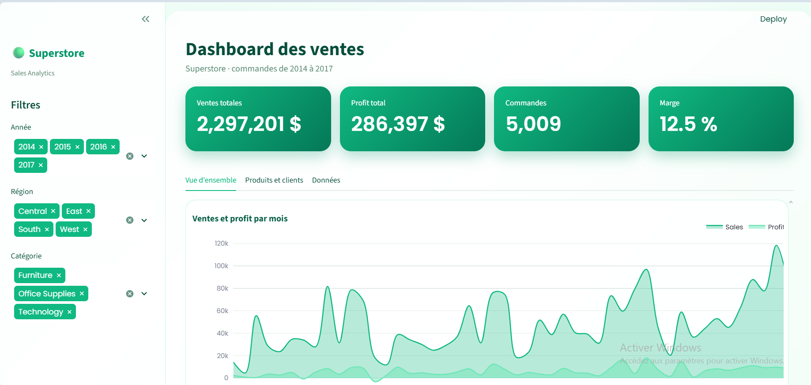

# 📊 Dashboard d'analyse des ventes — Superstore

Dashboard interactif d'analyse des ventes d'un magasin américain sur la période 2014–2017, développé avec **Python, pandas, Plotly et Streamlit**.

🔗 **Démo en ligne :** [Accéder au dashboard](https://superstore-sales-dashboard-t.streamlit.app/))



## 🎯 Objectif

Transformer un jeu de données de ventes brut en un tableau de bord interactif permettant de répondre rapidement à des questions business :

- Quels sont les ventes, le profit et la marge globale ?
- Comment les ventes évoluent-elles dans le temps ?
- Quelles catégories, régions et quels produits génèrent le plus de profit ou des pertes ?
- Quels sont les clients et segments les plus performants ?

## ✨ Fonctionnalités

- **4 indicateurs clés (KPI)** : ventes totales, profit total, nombre de commandes et marge.
- **Filtres interactifs** : année, région et catégorie.
- Évolution mensuelle des ventes et du profit.
- Analyse par catégorie, sous-catégorie, région et segment de clientèle.
- Top 10 des produits et top 10 des clients.
- Tableau de données avec export CSV des données filtrées.

## 📁 Données

- **Source :** [Superstore Dataset — Kaggle](https://www.kaggle.com/datasets/vivek468/superstore-dataset-final)
- **Volume :** 9 994 lignes et 21 colonnes.
- **Période :** janvier 2014 à décembre 2017.
- **Préparation :** conversion des dates au format mois/jour/année, vérification des valeurs manquantes et des doublons.

## 🔎 Chiffres clés

| Indicateur | Valeur |
|---|---:|
| Ventes totales | 2 297 201 $ |
| Profit total | 286 397 $ |
| Commandes | 5 009 |
| Marge globale | 12,5 % |

### Principaux enseignements

- Les ventes annuelles passent de **484 k$ en 2014** à **733 k$ en 2017**.
- La catégorie **Technology** génère le profit le plus élevé, avec environ **145 k$**.
- La catégorie **Furniture** génère environ **18 k$ de profit pour 742 k$ de ventes**, soit une marge d'environ **2,5 %**.

## 🛠️ Technologies utilisées

- **Python** — langage de programmation.
- **pandas** — nettoyage et analyse des données.
- **Plotly** — visualisations interactives.
- **Streamlit** — création de l'interface web du dashboard.

## ▶️ Installation et lancement en local

### 1. Cloner le dépôt

```bash
git clone https://github.com/takwakebaier2010-stack/superstore-sales-dashboard.git
cd superstore-sales-dashboard
```

### 2. Créer un environnement virtuel

```bash
python -m venv venv
```

### 3. Activer l'environnement virtuel

Sous Windows :

```bash
venv\Scripts\activate
```

Sous macOS ou Linux :

```bash
source venv/bin/activate
```

### 4. Installer les dépendances

```bash
pip install -r requirements.txt
```

### 5. Lancer le dashboard

```bash
streamlit run app.py
```

L'application sera accessible à l'adresse locale indiquée dans le terminal.

## 🗂️ Structure du projet

```text
superstore-sales-dashboard/
├── app.py                 # Application Streamlit
├── explore.py             # Exploration et calcul des KPI
├── requirements.txt       # Dépendances Python
├── data/
│   └── superstore.csv     # Jeu de données
├── docs/
│   └── screenshot.png     # Capture d'écran du dashboard
└── .streamlit/
    └── config.toml        # Configuration du thème
```

## 👩‍💻 Auteure

**Takwa Kebaier**  
Étudiante en Licence Business Information Systems — ISG Tunis.

🔗 [Mon profil LinkedIn](https://www.linkedin.com/in/takwa-kebaier)
